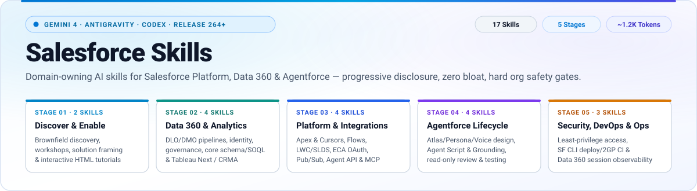
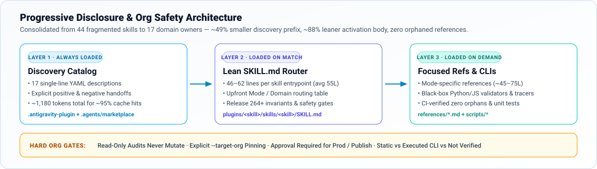

<div align="center">
<picture>
  <source media="(prefers-color-scheme: dark)" srcset="assets/hero-dark.svg">
  <source media="(prefers-color-scheme: light)" srcset="assets/hero-light.svg">
  
</picture>
<p>
  <a href="#quick-start">Quick Start</a> ·
  <a href="#skill-map">Skill Map (17)</a> ·
  <a href="#architecture">Architecture</a> ·
  <a href="#validation--ci">Validation &amp; CI</a> ·
  <a href="#authoring--conventions">Conventions</a> ·
  <a href="#provenance--mcp">Provenance &amp; MCP</a>
</p>
</div>

## Quick Start

<table>
<tr>
<td width="50%" valign="top">
<strong>Google Antigravity (Recommended)</strong><br>
Sync all 17 skills directly into <code>~/.gemini/config/skills/</code> without requiring the <code>agy</code> CLI, or load the native <code>.antigravity-plugin/plugin.json</code> manifest.
<pre lang="sh"><code>git clone https://github.com/jonathan-arteaga/salesforce-skills.git
cd salesforce-skills
python3 scripts/install_antigravity.py --sync-skills</code></pre>
</td>
<td width="50%" valign="top">
<strong>OpenAI Codex Marketplace</strong><br>
Add the <code>salesforce-skills</code> marketplace and install individual domain skills on demand via <code>.agents/plugins/marketplace.json</code>.
<pre lang="sh"><code>codex plugin marketplace add jonathan-arteaga/salesforce-skills
codex plugin add agentforce-build@salesforce-skills
codex plugin add salesforce-apex@salesforce-skills</code></pre>
</td>
</tr>
</table>

<details>
<summary><strong>Selective install, dry-run preview &amp; cleanup flags</strong></summary>
<pre lang="sh"><code># List all 17 discoverable skills
python3 scripts/install_antigravity.py --list
# Preview syncing a focused subset
python3 scripts/install_antigravity.py --sync-skills --skill agentforce-build --skill salesforce-apex --dry-run
# Sync selected skills and remove deselected skills from this repo
python3 scripts/install_antigravity.py --sync-skills --skill data360-data-pipeline --clean</code></pre>
</details>

## Skill Map

All **17 domain-owning skills** consolidated from 44 legacy plugins — organized 1-to-1 with the **5 lifecycle stages** above. Every skill enforces single-line Layer 1 discovery, a lean Layer 2 `SKILL.md` mode router, on-demand Layer 3 `references/*.md`, and hard org safety gates.

<table>
<tr>
<td colspan="2" valign="top">
<h3>Stage 01 · Discover &amp; Enable (2 skills)</h3>
<ul>
<li><a href="plugins/salesforce-discovery/skills/salesforce-discovery/SKILL.md"><strong>salesforce-discovery</strong></a> — Brownfield &amp; greenfield customer discovery, 12 industry patterns, Agentforce workshop facilitation, build-vs-reuse framing, and Well-Architected solution handoffs.</li>
<li><a href="plugins/salesforce-tutorial-builder/skills/salesforce-tutorial-builder/SKILL.md"><strong>salesforce-tutorial-builder</strong></a> — Turn a verified Salesforce or Agentforce teaching brief into a standalone single-file interactive HTML tutorial app or print-ready setup guide.</li>
</ul>
</td>
</tr>
<tr>
<td width="50%" valign="top">
<h3>Stage 02 · Data 360 &amp; Analytics (4 skills)</h3>
<ul>
<li><a href="plugins/data360-data-pipeline/skills/data360-data-pipeline/SKILL.md"><strong>data360-data-pipeline</strong></a> — DLO/DMO schema inspection CLI, ingestion vs Zero Copy federation, DLO-to-DMO mapping, Data Cloud One topology, and identity resolution rulesets.</li>
<li><a href="plugins/data360-activation-governance/skills/data360-activation-governance/SKILL.md"><strong>data360-activation-governance</strong></a> — Data spaces, access/masking policies, Data 360 SQL &amp; calculated insights, consent-aware segmentation, and authorized destination activation.</li>
<li><a href="plugins/salesforce-schema-data/skills/salesforce-schema-data/SKILL.md"><strong>salesforce-schema-data</strong></a> — Custom objects &amp; fields metadata, selective SOQL/SOSL with <code>WITH USER_MODE</code>, Bulk API 2.0, and authorized record operations with validators.</li>
<li><a href="plugins/salesforce-analytics/skills/salesforce-analytics/SKILL.md"><strong>salesforce-analytics</strong></a> — Tableau Next semantic models, dashboards &amp; multi-layer governance plus CRM Analytics (Wave) recipes, datasets, XMD, and row-level security.</li>
</ul>
</td>
<td width="50%" valign="top">
<h3>Stage 03 · Platform &amp; Integrations (4 skills)</h3>
<ul>
<li><a href="plugins/salesforce-apex/skills/salesforce-apex/SKILL.md"><strong>salesforce-apex</strong></a> — API 67+ <code>WITH USER_MODE</code> Apex services &amp; Cursors, bulkified unit tests, Unified Logic Testing execution, and debug-log governor-limit diagnosis.</li>
<li><a href="plugins/salesforce-flow/skills/salesforce-flow/SKILL.md"><strong>salesforce-flow</strong></a> — Record-Triggered, Screen, Autolaunched &amp; Omni-Channel Agentforce routing Flows, plus Flow XML auditing for bulkification, fault paths, and context risk.</li>
<li><a href="plugins/salesforce-lwc/skills/salesforce-lwc/SKILL.md"><strong>salesforce-lwc</strong></a> — Lightning Web Components with LDS/GraphQL mutations, State Managers, TypeScript, SLDS 2 styling hooks, Jest tests, and bundled SLDS/LSP validators.</li>
<li><a href="plugins/salesforce-integrations/skills/salesforce-integrations/SKILL.md"><strong>salesforce-integrations</strong></a> — External Client Apps &amp; OAuth, Named/External Credentials, Pub/Sub 72h events &amp; CDC, Agent API streaming lifecycle, and Hosted MCP Servers.</li>
</ul>
</td>
</tr>
<tr>
<td width="50%" valign="top">
<h3>Stage 04 · Agentforce Lifecycle (4 skills)</h3>
<ul>
<li><a href="plugins/agentforce-design/skills/agentforce-design/SKILL.md"><strong>agentforce-design</strong></a> — Atlas Reasoning &amp; hybrid architecture, persona calibration &amp; linter, conversation design, Voice UX (<code>modality voice:</code>, consent/recording), and HTML TDDs.</li>
<li><a href="plugins/agentforce-build/skills/agentforce-build/SKILL.md"><strong>agentforce-build</strong></a> — Agent Script &amp; <code>aiAuthoringBundle</code> implementation, topics/actions/overrides, Data Libraries &amp; custom retrievers, and multi-version Prompt Builder templates.</li>
<li><a href="plugins/agentforce-review/skills/agentforce-review/SKILL.md"><strong>agentforce-review</strong></a> — Read-only design-time metadata &amp; invocation graph CLI, scored config/permission audits, regulated-industry safeguards, and improvement-loop planning.</li>
<li><a href="plugins/agentforce-test/skills/agentforce-test/SKILL.md"><strong>agentforce-test</strong></a> — Structured Agentforce test specs, routing-derived escalation &amp; handoff scenarios, <code>sf agent test run</code> execution, and Flex Credit / sandbox evidence boundaries.</li>
</ul>
</td>
<td width="50%" valign="top">
<h3>Stage 05 · Security, DevOps &amp; Ops (3 skills)</h3>
<ul>
<li><a href="plugins/salesforce-security-access/skills/salesforce-security-access/SKILL.md"><strong>salesforce-security-access</strong></a> — Permission Sets, PSGs, muting &amp; sharing matrices, Agentforce runtime identity &amp; Trust Layer boundaries, and My Trust Center / Experience Cloud posture.</li>
<li><a href="plugins/salesforce-devops-deploy/skills/salesforce-devops-deploy/SKILL.md"><strong>salesforce-devops-deploy</strong></a> — Scratch orgs &amp; snapshots, pinned <code>--target-org</code> validation &amp; <code>RunSpecifiedTests</code> deploys, 2GP Unlocked/Managed packaging, and DevOps Center CI.</li>
<li><a href="plugins/agentforce-observe/skills/agentforce-observe/SKILL.md"><strong>agentforce-observe</strong></a> — Single-session Data 360 tracing CLI (strict data-space error boundaries), aggregate production trends, voice latency &amp; Flex Credit anomalies, and authorized alerts.</li>
</ul>
</td>
</tr>
</table>

## Architecture

<div align="center">
<picture>
  <source media="(prefers-color-scheme: dark)" srcset="assets/architecture-dark.svg">
  <source media="(prefers-color-scheme: light)" srcset="assets/architecture-light.svg">
  
</picture>
</div>

## Validation & CI

Every pull request and push runs [`.github/workflows/verify-marketplace.yml`](.github/workflows/verify-marketplace.yml) to verify manifest lockstep, single-line YAML frontmatter, verbatim `plugin.json` ↔ `SKILL.md` description parity, zero raw HTML or escaped-pipe tables, zero orphaned `references/` files, routing test fixtures, and all bundled Python CLI test suites:

```sh
python3 -m pip install -r requirements-validation.txt
python3 scripts/package_marketplace.py --check
python3 scripts/validate_skills.py
python3 -m unittest discover -s tests -v
```

<details>
<summary><strong>Bundled black-box CLI unit test suites (also enforced in CI)</strong></summary>
<pre lang="sh"><code># Agentforce design-time metadata analyzer CLI tests
python3 -m unittest discover -s plugins/agentforce-review/skills/agentforce-review/scripts/tests -t plugins/agentforce-review/skills/agentforce-review/scripts
# Agentforce Data 360 single-session tracer CLI tests
python3 -m unittest discover -s plugins/agentforce-observe/skills/agentforce-observe/scripts/tests -t plugins/agentforce-observe/skills/agentforce-observe/scripts</code></pre>
</details>

## Authoring & Conventions

Read [CONVENTIONS.md](CONVENTIONS.md) for the complete authoring philosophy, progressive-disclosure budgets, and org safety gates. Scaffold new skills automatically with `scripts/new_skill.py` and keep both manifests in lockstep with `scripts/package_marketplace.py`:

```sh
python3 scripts/new_skill.py salesforce-example \
  --display-name "Salesforce Example" \
  --category "Core Platform & Integrations" \
  --short-description "Handle one crisp Salesforce platform domain cleanly." \
  --description "Handle one crisp Salesforce workflow with org safety gates. Use salesforce-apex for Apex."
```

## Provenance & MCP

- **Documentation baseline:** See [Salesforce guidance](docs/salesforce/README.md), [gap assessment](docs/salesforce/gap-assessment.md), [practitioner evidence](docs/salesforce/practitioner-insights.md), and [validation results](tests/results/2026-11-15-salesforce-expansion.md).
- **Salesforce Docs MCP:** The standalone read-only [Salesforce Docs MCP connection](integrations/salesforce-docs-mcp/README.md) is packaged outside the skill catalog intentionally.
- **Extraction history:** Originally extracted from `jonathan-arteaga/arteaga-ai-skills` at baseline `68c6c18a4bc3cf7f2ef0e24109f3b2140b864e00` (historical baseline checksums preserved in [migration-manifest.json](migration-manifest.json)), then consolidated and modernized to 17 Gemini 4 / Antigravity skills. All packaged skills carry Apache-2.0 `LICENSE` files.
